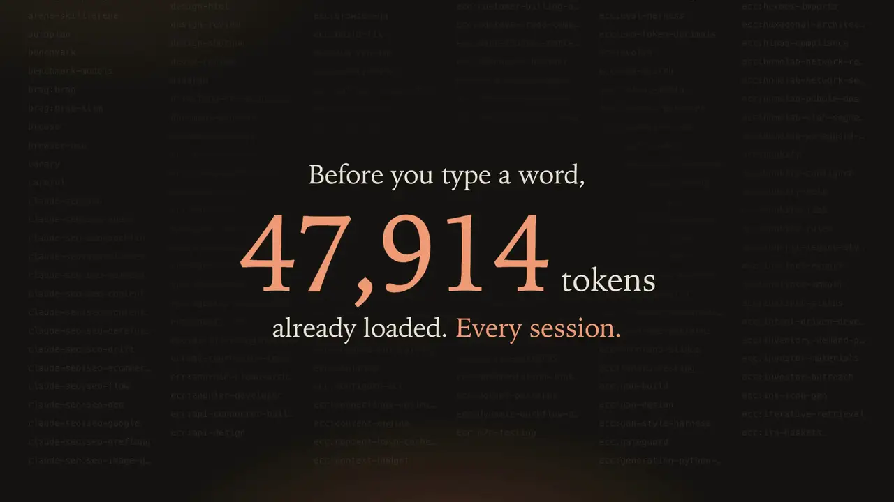

# Claude Skills Dashboard

A local web dashboard for everything your Claude Code can load — personal skills, plugin skills,
commands and agents — and what each one costs you in tokens.

<p align="center">
  <a href="https://github.com/Hardik203/claude-skills-dashboard/releases/download/v1.0.0/skills-dashboard-demo.mp4">
    
  </a>
  <br>
  <sub><a href="https://github.com/Hardik203/claude-skills-dashboard/releases/download/v1.0.0/skills-dashboard-demo.mp4">▶ Full video with sound (29 s, MP4)</a></sub>
</p>

- **See everything** installed, searchable and grouped into categories
- **Enable / disable** any personal skill or plugin with a switch; **delete** to the Trash
- **Install** skills from any GitHub repo (preview the skills in it and pick which ones) or plugins
  from your marketplaces, sortable by install count
- **Token budget**: how many tokens your skills add to *every* session, what each one costs
  always-on and when used, and a live total that updates as you flip switches
- **Real usage**: how often you've actually used each skill, from your local session history
- **Clean up in one click**: "Disable unused" and "Trim heaviest plugins", both with Undo

Everything runs on your machine, bound to `127.0.0.1`. Nothing is uploaded anywhere.

## Install

### As a Claude Code plugin (recommended)

Inside Claude Code:

```
/plugin marketplace add Hardik203/claude-skills-dashboard
/plugin install skills-dashboard@claude-skills-dashboard
```

Or from a terminal:

```bash
claude plugin marketplace add Hardik203/claude-skills-dashboard
claude plugin install skills-dashboard@claude-skills-dashboard
```

Then start a new Claude Code session and ask *"open my skills dashboard"* (or run
`/skills-dashboard:skills-dashboard`).

### As a personal skill

```bash
git clone --depth 1 https://github.com/Hardik203/claude-skills-dashboard /tmp/skills-dashboard
cp -R /tmp/skills-dashboard/plugin/skills/skills-dashboard ~/.claude/skills/
```

### Without Claude at all

The skill folder is self-contained — run its server directly:

```bash
node plugin/skills/skills-dashboard/scripts/server.mjs
```

It opens http://127.0.0.1:5179 (or the next free port). Options: `--port <n>`, `--no-open`.

## Requirements

- **Node.js 18+** or **Bun** to run the server — no `npm install` needed, it's a single bundled file
- The **`claude` CLI** on your `PATH` (used to list, toggle and install plugins)
- macOS or Linux. Windows should work but is untested.

## How the numbers work

- **Always-on tokens** — each enabled skill's name and description go into every session's system
  prompt. Estimated at ~4 characters per token, the same method `claude plugin details` uses;
  checked against it to within a few percent. Plugin agents are included, since they're also always loaded.
- **When used** — the rest of the `SKILL.md`, loaded only when the skill runs.
- **Usage** — counts Skill tool calls, slash commands you typed, plugin agent calls and plugin MCP
  tool calls in `~/.claude/projects`. Claude Code deletes old transcripts, so "not used" means
  "not used in the history that still exists" — the dashboard shows that window.
- **Categories** are inferred from each skill's name and description (or a `category:` in its
  frontmatter), so a few will land somewhere odd.

## What it changes on disk

| Action | What happens |
| --- | --- |
| Disable a personal skill | Folder moves to `~/.claude/skills-disabled/` (moved back on enable) |
| Delete a personal skill | Folder moves to the Trash (`~/.claude/.skills-trash` on Linux/Windows) |
| Install from GitHub | Selected skill folders are copied into `~/.claude/skills/` (symlinks skipped) |
| Plugin enable / disable / install / uninstall | Runs the matching `claude plugin …` command |

Changes take effect in **new** Claude Code sessions. Only install skills from sources you trust —
a skill can instruct Claude to run commands.

## Develop

```bash
bun install
bun run dev            # Vite dev server with the API, http://127.0.0.1:5173
bun run build:plugin   # rebuild plugin/skills/skills-dashboard/{app,scripts/server.mjs}
```

Source lives in `src/` (React UI), `server/` (API + standalone server) and `shared/`. The installable
plugin is just `plugin/` — its `app/` and `scripts/server.mjs` are build output, committed so installs
work with no build step and no dependencies. (It's kept out of the repo root on purpose: a
`package.json` at a plugin's root makes Claude Code install its dependencies for every user.)

## License

MIT
